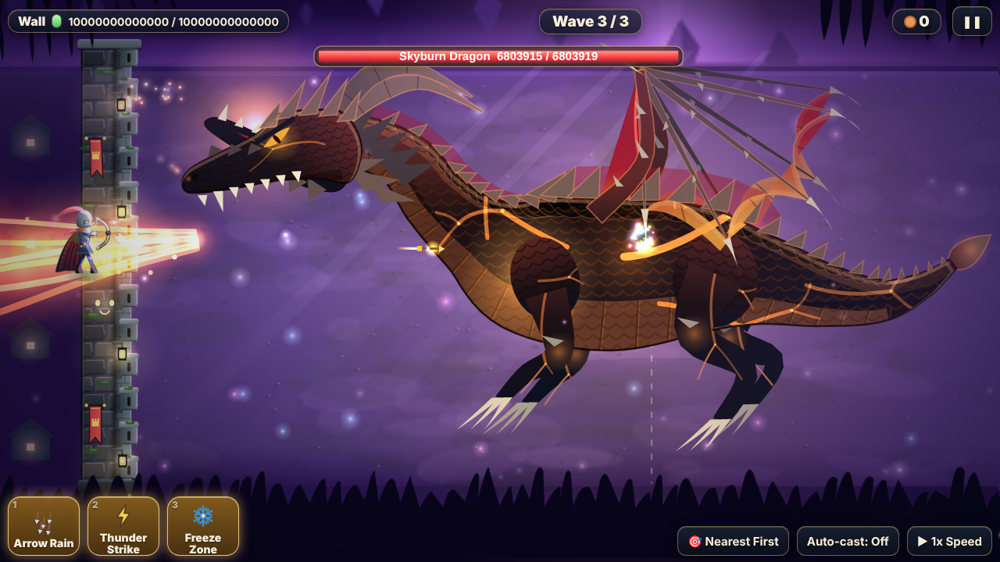
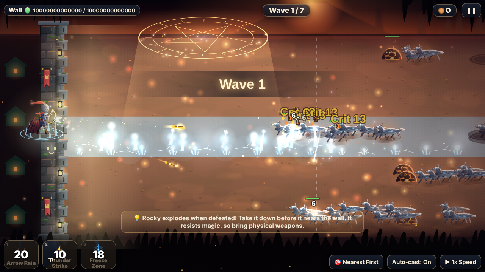
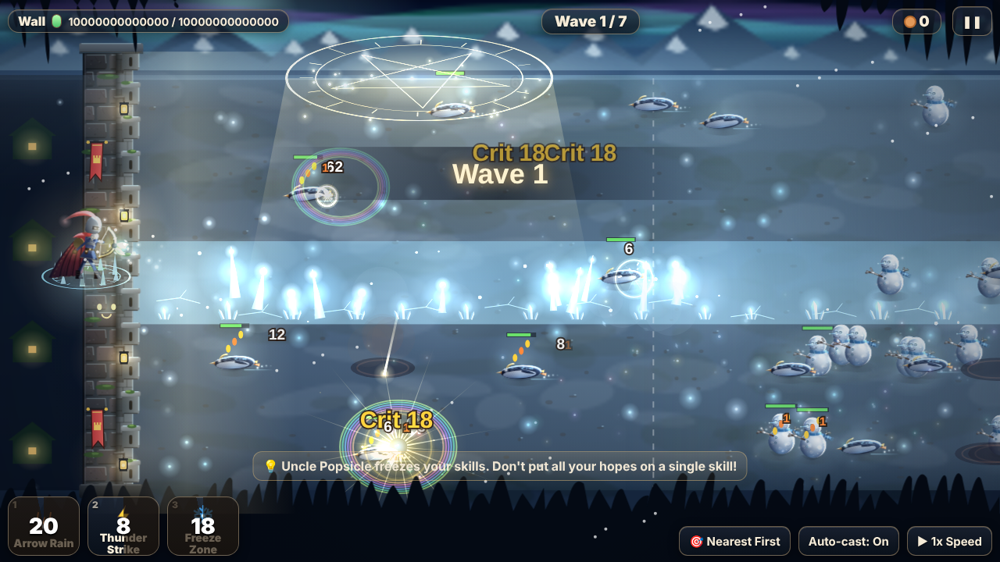
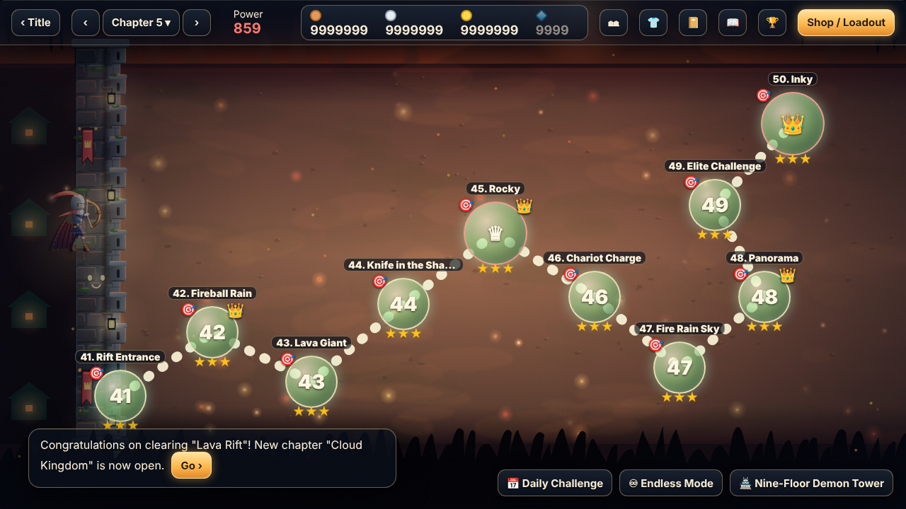
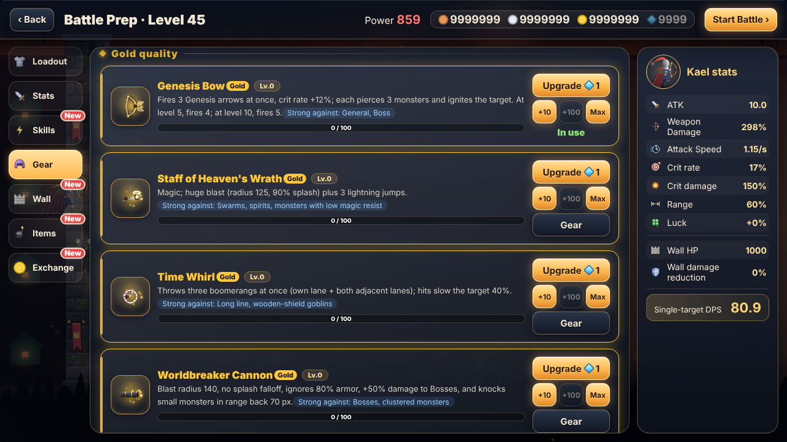

## Hold the wall. Cast your skills. Slay the dragon.

**Archer on the Wall** is a 2D side-view tower defense that plays itself — and rewards you for how you prepare. Your archer stands on the castle wall and shoots automatically. Monsters march in along the lanes. **You decide the build before the fight, and you cast skills, throw items and call waves during it.** If the wall falls, you lose.

Free, runs in your browser, no install, no account. Your save lives in your browser (export / import in Settings).

### What's in the game

- **200 levels in 20 chapters** — green meadows, golden desert, foggy swamp, frozen tundra, lava rift, cloud kingdom, coral bay, moonlit castle, iron forge, the void sky… and, once you clear level 100, the **Abyss Echo**: ten more chapters with tougher remixes of everything you've fought.
- **14 bosses + 6 "echo" bosses**, each with phases and a trick to learn — interrupt the charge-up, strike in the window, break the shield first. The last one is a **two-life dragon**: it breathes fire, rams the wall, calls lightning that **paralyzes your archer for 2 s** and ice that **freezes them for 3 s** — and when it falls, it comes back black and three times as strong.
- **5 heroes**, **25 weapons** in five quality tiers (green → blue → purple → red → gold; the top ones fire multiple arrows, pierce, ignite), **10 active skills**, **10 passive skills** (lightning, frost nova, fireballs, spirit arrows…), **180 pieces of gear** in six slots, **45 consumables**, wall upgrades, a **wardrobe** of 10 characters.
- **Nine-Floor Demon Tower**, **Endless mode**, **Daily Challenge**, a monster codex, achievements, and an optional mission on every level.
- **Three difficulties** (relaxed / normal / challenge — with crowns for the hardest clears) and "reinforcements" help if you keep failing a level.
- **Hand-lit 2D look**: each chapter has its own light, fog, light shafts and drifting motes; the wall cracks as it takes damage; every skill has its own animation. The game lowers effects automatically if your machine struggles (Settings → Graphics Quality).
- **Symphonic soundtrack** with 23 pieces that layer up with the tension of the fight.
- **17 languages**: English, 简体中文, 繁體中文, Español, Português (BR / PT), Русский, 日本語, 한국어, Deutsch, Français, Türkçe, Polski, Italiano, Bahasa Indonesia, Tiếng Việt, ภาษาไทย. *Translations were machine-generated and have not been reviewed by native speakers — corrections are very welcome.*

### How to play

| Action | Control |
|---|---|
| Cast active skill 1 / 2 / 3 | Click the skill button, or press **1 / 2 / 3** |
| Skills that need a lane (Freeze Zone, Flame Wall, bombs…) | Click the skill, then click a lane. Right-click or **Esc** cancels |
| Use consumables | **Q W E R Z X C** (or click) |
| Pause | **Space** |
| Game speed | **F** (3× unlocks after level 10) |
| Call the next wave early (leftover countdown becomes copper) | **N** |
| Switch target priority | **T** |

1. Your archer shoots on its own. Pick **weapon, skills, gear and items** in the shop before each battle.
2. Clear a level with ≥ 50 % wall HP for 2 stars, ≥ 80 % for 3.
3. Spend copper, silver, gold and diamonds on upgrades — **diamonds only come from the Demon Tower**.
4. Read the tip at the start of each level: new monsters usually come with a counter.

### Tips

- Bosses telegraph their big attacks. Save a skill for the moment they open up.
- Ice stops your skills; lightning stops your archer. Items that grant stun immunity are worth carrying against the final dragon.
- Weapons are strong against specific enemies (swarms, flyers, armored, bosses) — match them to the chapter.

### Changelog

- **v1.21** — Fixed the English (and other non-Chinese) UI turning back into Chinese a few seconds into a battle. Quit button hidden when embedded in a web page.
- **v1.20** — The final dragon is redrawn from scratch as a vector model: new body, wings with finger bones and scalloped membrane, detailed head, and a dedicated charge-up and release animation for each of its four skills.
- **v1.19** — Weapon level caps by quality (green 20 · blue 40 · purple 60 · red 80 · gold 100); upgrade cost ×1.3 per level.
- **v1.18** — Dragon gains ram, lightning and ice attacks; ice freezes the archer 3 s, lightning paralyzes 2 s.
- **v1.15** — Two-life dragon with story scene; red and gold gear priced up; gold gear upgrades with diamonds.
- **v1.11** — Levels expanded from 100 to 200 (Abyss Echo, chapters 11–20).
- **v1.10** — Balance, polish, effects, bug-hunt and low-end-PC pass.
- **v1.03** — Symphonic soundtrack.
- **v0.75** — 17 languages.

### Credits

Design, code, art direction and music arrangement by the developer; built with the help of **Claude** (Anthropic) — see the AI disclosure on this page.
Instrument samples for the soundtrack come from the **FluidR3_GM** sound font by Frank Wen (via gleitz/midi-js-soundfonts and surikov/webaudiofontdata), licensed **CC BY 3.0**. Everything else — graphics, animation, sound effects — is drawn and synthesized by code at runtime.

*Known limits: this is a web prototype. Balance has been checked up to roughly level 68 with an automated player; the late chapters are tuned by feel, so feedback on difficulty is welcome. Tested on desktop Chromium; other browsers and phones are untested.*
